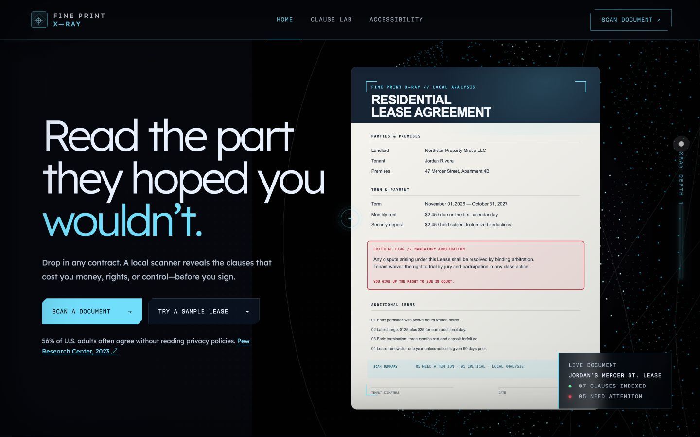
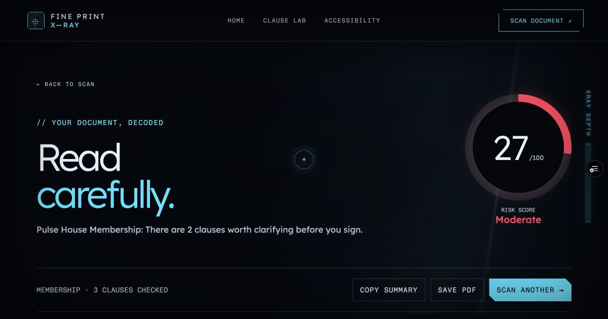
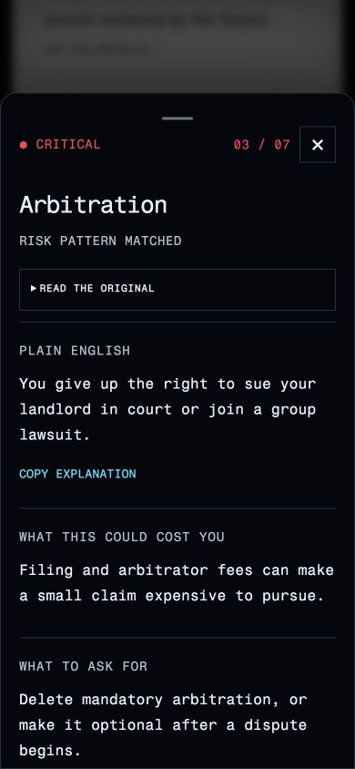

# Fine Print X-Ray

[Open the live app](https://hyperbloom-two.vercel.app/) · [Verification](docs/QA.md) · [Review checklist](docs/REVIEW_CHECKLIST.md)

Read the part they hoped you wouldn’t. A local, rule-based contract scanner that
turns dense terms into questions, proposed revisions and practical next steps.



## From finding to action

1. Drop a PDF / DOCX / TXT, paste text, or choose one of four fictional samples.
   Agreement type is detected and can be overridden, including Membership.
2. Review critical findings first. Gray **Not flagged** means unassessed, not
   safe. Reading view exposes every clause; paper view paginates long documents.
   Phones use one full-width reading list and a focused details sheet.
3. Act on a report: separate money scenarios with explicit assumptions, original
   versus proposed wording, an editable email, calendar reminders and a checklist.
   Review state survives refresh in tab-only session storage and can be cleared.



## Why this design

Jordan, Dev and Rosa are illustrative personas—a renter, a freelancer and a gym
member—not research participants. The design uses cyan/ink surfaces and tactile
paper without making the visual effect a prerequisite to reading.
Severity pairs a color with a shape and label; unknown language has its own gray
state. The score is an explained prioritization formula, never a probability.
The sweep is a presentation of clauses already checked locally.

## Accessibility and privacy

Live controls offer reduced motion, high contrast, light theme, larger text and
Atkinson Hyperlegible. Explanations and report verdicts can be shown in Spanish;
source wording, navigation and some report controls remain in English. Clause Lab includes nine specimens
and a three-question, self-paced quiz. Keyboard focus, dialogs and announcements
are documented in [QA](docs/QA.md), including what was not tested.



Document extraction, rules, drafts and reminders run on the device. Text is not
sent to an AI service. Documents are remembered only for this tab session;
preferences use local storage. Clear the document from the scan to remove it.

## Development

Node 22; pnpm 11.25.0. The same versions are used by CI and Vercel.

```bash
npm install --global pnpm@11.25.0
pnpm install --frozen-lockfile
pnpm dev
pnpm test
pnpm typecheck
pnpm build
pnpm preview
```

Build runs TypeScript, 56 regression tests, then Vite. Current verification results are
in QA.md. Routes use hashes so static hosting and shared sample links work.
Keep future commits descriptive: e.g. “Fix mobile clause filters and preserve
neutral analysis states”, not “fixed bugs”.

## Architecture and limits

React / TypeScript / Vite; locally bundled pdf.js and Mammoth; ThreeUI scenes
use one cached Three.js r149 asset loaded only for rendered scenes. Each paper
iframe executes it in its own window: cross-window WebGL/CanvasTexture
constructors must never be borrowed from the parent.
Intake and report use a lightweight CSS field. App styles are consolidated in
`src/xray/styles.css`; dedicated shader styles remain with their components.

This is not legal advice. Rules can miss differently worded risks or flag a
clause whose exception matters. Unmatched text must still be read. Scanned PDFs
need external OCR; there is no automatic OCR or first-time offline installation.
Proposed wording is a negotiation starting point, not a reviewed legal template.
Full independent-contract benchmarks, physical-device tests, actual screen-reader
sessions and participant research remain distinct from automated audit scores.

## Credits and license

ThreeUI / Design+Code authored the 3D Paper, Orbital Sphere and Dot Matrix source.
We adapted document CanvasTextures, clause UV mapping, page-turn data, pagination,
local loading and analysis interactions. Three.js,
React, pdf.js, Mammoth and the font authors retain their original licenses.
See [third-party notices](THIRD_PARTY_NOTICES.md); the exact 3D Paper redistribution rights
must be confirmed with the account owner. Public Community orbital and dot-matrix
components are MIT licensed. The [MIT license](LICENSE) applies
only to original application code, not those third-party sources.

[Submission draft](docs/SUBMISSION.md) · [Recording plan](docs/DEMO_SCRIPT.md) ·
[Human testing protocol](docs/TESTING_PROTOCOL.md) · [Continuing product standard](docs/PRODUCT_STANDARD.md)
